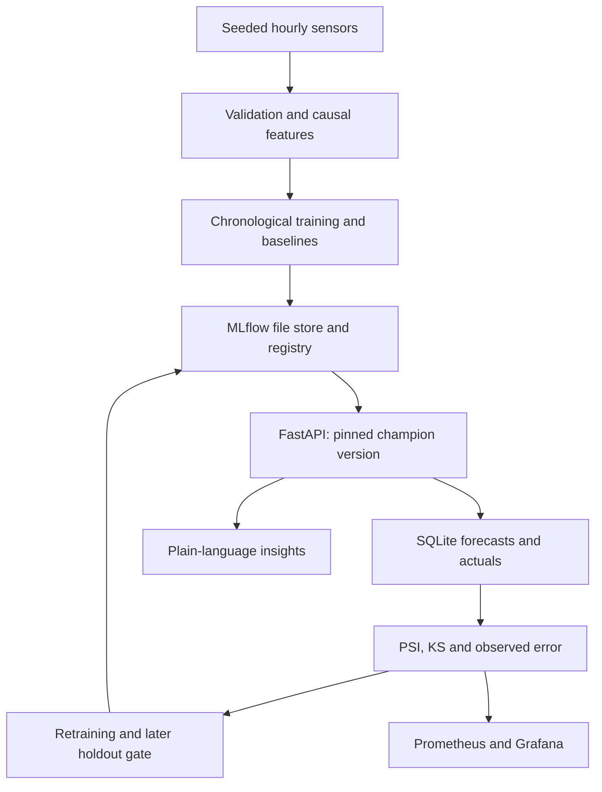
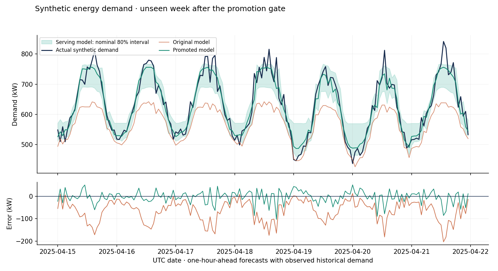

# Energy Demand Forecasting Service

A small, end-to-end MLOps project: reproducible raw hourly data → validated causal features → tracked gradient boosting → a versioned FastAPI service → monitoring → evaluated retraining.

**All data and results are synthetic.** This demonstrates engineering and evaluation practices, not validated energy-industry performance, climate projections, carbon savings, or a deployed production system. Default operation is local, CPU-only, and makes no paid API calls or dataset downloads.

## Architecture



## Quick start — no Docker needed

Use Python **3.12** on Linux/macOS. Python 3.11 is allowed by package metadata but was NOT VERIFIED. Windows requires WSL because the retraining lock uses `fcntl`. Run commands from the repository root.

```bash
python3.12 -m venv .venv
source .venv/bin/activate
pip install -r requirements.lock
pip install --no-deps -e .

energy generate --output runtime/raw.csv
energy validate runtime/raw.csv
energy train --data runtime/raw.csv --output docs
uvicorn energy.api:create_app --factory --host 127.0.0.1 --port 8000
```

In a second activated terminal:

```bash
energy example > runtime/request.json
curl -s http://127.0.0.1:8000/health
curl -s http://127.0.0.1:8000/model-version
curl -s http://127.0.0.1:8000/predict \
  -H 'Content-Type: application/json' --data @runtime/request.json
curl -s http://127.0.0.1:8000/monitoring
curl -s http://127.0.0.1:8000/metrics
```

Interactive API documentation: [localhost:8000/docs](http://localhost:8000/docs).

`energy train` without `--data` generates the same seeded raw data in memory. Initial training deliberately refuses to overwrite a champion. To rerun from scratch without deleting anything, use a new `ENERGY_RUNTIME` directory and leave `MLFLOW_TRACKING_URI` unset:

```bash
export ENERGY_RUNTIME=runtime/another-experiment
energy train --output runtime/another-experiment/evidence
```

The configuration is [config/default.yaml](config/default.yaml). CLI overrides use `energy --config path.yaml train`; the API reads `ENERGY_CONFIG`. Python commands read **exported variables**, not `.env` automatically. No model binaries or mutable stores are committed; recreate them with training.

## Forecast contract and endpoints

This is a **one-hour-ahead, single-series** model. Each request supplies 168 consecutive observed hourly demand values, oldest first, ending exactly one hour before `forecast_at`. The API checks length, range, finiteness, timezone, hour alignment and `history_end`. It cannot independently prove that caller-supplied history has no omitted or fabricated readings.

Temperature is an assumed weather forecast for the target hour; holiday status is known in advance. A batch contains **independent one-hour forecasts**, each with its own observed history; it is not a recursive future trajectory. The example request is a historical synthetic contract example, not a live sensor reading.

| Method / path | Behavior |
|---|---|
| `GET /health` | Model and ledger readiness; 503 if champion is unavailable |
| `GET /model-version` | Loaded version, training cutoff, restart policy |
| `POST /predict` | Point estimate, lower/upper bounds, nominal coverage, prediction ID |
| `POST /predict/batch` | 1–128 independently validated forecasts; one atomic ledger write |
| `POST /actuals` | Match an observed value to a prediction ID; 404 unknown ID, 409 conflicting replacement |
| `GET /monitoring` | Version-specific PSI/KS drift and error once enough actuals arrive |
| `GET /metrics` | Prometheus counters, latency histogram, readiness, drift, MAE and sample count |
| `POST /insights` | A logged forecast plus deterministic plain-language uncertainty/drift summary |

Every successful single, batch, or insight forecast is logged to SQLite before it is returned. A storage failure returns 503 rather than an unlogged success. Input errors return 422. Submit actuals as:

```bash
curl -s http://127.0.0.1:8000/actuals -H 'Content-Type: application/json' \
  -d '{"prediction_id":"ID_FROM_PREDICT","actual_kw":540.0}'
```

The API loads a **specific registry version at startup**. After promotion, restart it to load the new champion. It deliberately does not hot-swap mid-request. Metrics counters are process-local and reset on restart; the SQLite ledger persists.

## Data and feature engineering

The seed-42 generator creates 9,600 UTC hours with daily, weekly and yearly patterns, nonlinear heating/cooling demand, a simplified synthetic holiday calendar, Gaussian noise, missing readings and occasional out-of-range sensors. The holiday calendar is illustrative, not an official national calendar. Units are **kW** and **°C**.

Validation reports schema, duplicate/cadence problems, ranges, missing counts and example bad-row positions. Structural errors, invalid holidays, nonnumeric sensors, or more than 5% invalid values in a sensor column fail the pipeline. Small sensor faults are quarantined. Temperature and historical demand may be forward-filled for at most three hours; current demand labels are never imputed. Unresolved feature/label rows are dropped.

| Features | Definition / availability |
|---|---|
| `temperature`, `holiday` | Known forecast/calendar information for hour t |
| `hour_sin`, `hour_cos`, `weekday` | Calendar information for hour t |
| `year_sin`, `year_cos` | Annual calendar cycle using day of year / 365.25 |
| `lag_1`, `lag_24`, `lag_168` | Actual demand at t−1, t−24, t−168 |
| `rolling_mean_24`, `rolling_std_24` | Mean and population standard deviation of t−24 through t−1 |

Offline and online paths use the same feature builder. The leakage test changes demand at t and later and verifies that features through t stay identical, including across missing readings. Earlier validation actuals may be used for later validation lags: this models walk-forward one-hour forecasting with arriving observations, not a full-horizon forecast issued once.

The first 80% of complete rows train the models; the last 20% are validation. The point model uses squared-error gradient boosting; two separate models use 0.1 and 0.9 quantile losses. Bounds are ordered and expanded to include the point prediction. Feature importances, parameters, metrics, data SHA-256, quality report and time boundaries are logged in MLflow. A single registered artifact contains all three estimators and the training reference window.

## Measured results

From the saved runs in [docs/training_results.json](docs/training_results.json) and [docs/drift_demo.json](docs/drift_demo.json). MAPE excludes zero-demand observations and reports the excluded count (zero in these runs).

| Initial chronological validation | MAE (kW) | RMSE (kW) | MAPE |
|---|---:|---:|---:|
| Gradient boosting | 15.27 | 19.13 | 2.59% |
| Naive: previous hour | 21.35 | 26.59 | 3.62% |
| Seasonal naive: same hour last week | 22.79 | 29.38 | 3.86% |

Nominal 80% interval: **81.16%** observed coverage, **62.29 kW** average width. These results describe one synthetic seed and one split; they are not cross-site or real-world validation.

## Drift and retraining demonstration

After initial training:

```bash
energy demo --output docs
# Restart any running API now to load the newly promoted version.
python scripts/smoke_api.py --output docs/api_smoke.json
```

The demo adds **11°C** to temperature and changes the demand meter's gain/offset to `1.22 × demand + 65 kW`. It logs 336 early shifted forecasts and their actuals, then checks drift and degraded MAE. Seventy shifted days supply adaptation and a later promotion holdout. The next fourteen days remain untouched until the promotion decision is complete.

A candidate is registered when retraining is triggered. Promotion requires more than **2% lower MAE than the incumbent on the same later holdout**. The saved run promoted version 2: gate MAE was **57.70 → 16.30 kW**. Tests also exercise rejection and no-trigger decisions. A process lock prevents concurrent retrainers. Previously used evaluation windows, including rejected-candidate holdouts, cannot be reused; monitoring triggers must precede the promotion holdout.

| Untouched 14-day future test (336 hours) | MAE (kW) | RMSE (kW) | MAPE | Interval coverage |
|---|---:|---:|---:|---:|
| Original model | 68.84 | 84.10 | 9.97% | 28.87% |
| Serving model after promotion | 22.27 | 29.30 | 3.42% | 73.81% |

**Drift remained detectable after retraining**, and interval coverage remained below its nominal 80%. Lower prediction error does not prove that data drift has disappeared or intervals are calibrated. See [the complete decision](docs/retraining_decision.json), [per-hour predictions](docs/demo_forecasts.csv), and this first-week view:



For a separate future synthetic CSV, after logging recent forecasts and actuals:

```bash
energy retrain --data runtime/new-synthetic-hours.csv --output runtime/retraining-evidence
```

Use new data after all previous evaluation windows, with at least 168 warm-up hours. Decisions are saved to SQLite and JSON. Retraining is explicit; no scheduler runs in the background. Replaying `energy demo` advances from the current champion's evaluation end and is a new experiment, not an identical replay. Use a fresh runtime to reproduce the published version-1/version-2 comparison.

## Monitoring and deployment

Monitoring uses at most the latest 336 logged forecasts for the **loaded version**; at least 48 samples are needed. Drift requires PSI > 0.2 **and** KS p < 0.01 / number of features. PSI uses training quantile bins, smoothed counts and explicit constant-feature handling. Performance monitoring compares matched MAE against 1.25 × the loaded model's validation MAE. Unknown sample states are explicit; Prometheus uses −1 for insufficient-data drift/MAE gauges.

**Docker image build and Compose configuration: verified in GitHub Actions. Running the full Compose stack (Grafana, Prometheus, MLflow UI): NOT VERIFIED.** The GitHub workflow runs lint, formatting, tests, the pipeline/demo, live HTTP smoke, Compose configuration validation and Docker build; its first run on `main` passed.

```bash
cp .env.example .env
# Set GRAFANA_ADMIN_PASSWORD in .env.
docker compose build api
# Initialize the named runtime volume before starting the MLflow UI.
docker compose run --rm api energy train --output /app/runtime/evidence
docker compose up -d
```

The API and MLflow UI share the **same absolute container artifact path** and UID. The API uses the local file store; the MLflow service provides the UI. Host and container runtimes are separate: do not copy a host MLflow store with absolute artifact paths into the container.

| Local URL | Service |
|---|---|
| [localhost:8000/docs](http://localhost:8000/docs) | API documentation |
| [localhost:5000](http://localhost:5000) | MLflow UI |
| [localhost:9090](http://localhost:9090) | Prometheus |
| [localhost:3000](http://localhost:3000) | Grafana: provisioned **Energy Demand Service** dashboard |

Grafana includes forecast rate, p95 latency, drift status, MAE, actual count, readiness, errors and scrape availability. All published ports bind to loopback. Four containers are optional and heavier than the local Python workflow. The API image runs as a non-root user. Do not expose this demonstration stack to the public internet.

The default insights provider is a deterministic template. Optional exported variables `INSIGHT_PROVIDER=openai`, `LLM_BASE_URL`, `LLM_MODEL`, and `LLM_API_KEY` enable an OpenAI-compatible chat-completions provider. Only the aggregate summary is sent. Missing credentials or provider failures fall back to the template. **Real provider integration is NOT VERIFIED**; enabling a remote provider can incur its costs. Credentials stay in the environment; no live calls were made.

## Tests and evidence

```bash
ruff check .
ruff format --check .
pytest
python scripts/smoke_api.py
# Full local gate, including an isolated reproducibility rerun:
python scripts/verify.py
# Optional plot regeneration:
pip install -e '.[plots]'
python scripts/plot_demo.py
```

| Area | Verified here / NOT VERIFIED |
|---|---|
| Python 3.12, data generation/validation, causal features | Verified |
| Training, baselines, quantiles, MLflow file-store registry roundtrip | Verified; actual artifacts in the local runtime |
| Drift trigger, retraining, evaluated promotion, future test | Verified; saved JSON/CSV and figure |
| Pytest | **36 passed**; upstream dependency warnings are retained in the test log |
| Ruff lint and format | Verified clean |
| Running API over loopback HTTP | **9 checks passed**; not only TestClient tests |
| Reproducibility of training and demo | Verified by a fresh isolated rerun; see verification report |
| Docker image build, Compose config validation | Verified in GitHub Actions (run #1 passed) |
| Running Compose stack, Grafana dashboard, Prometheus scraping, MLflow UI | **NOT VERIFIED** |
| GitHub Actions workflow (lint, format, tests, training, demo, API smoke, image build) | Verified; first run passed |
| Remote LLM | **NOT VERIFIED**; default/fallback tested locally |
| Real energy data, load capacity, Windows/native or Python 3.11 | **NOT VERIFIED** |

See [docs/VERIFICATION.md](docs/VERIFICATION.md) for commands, results and limitations; [DECISIONS.md](DECISIONS.md) for design rationale.

## Limitations and the move to real sensors

- Synthetic data omits outages, site heterogeneity, tariffs, occupancy changes and many actual demand drivers. A meter calibration change should usually be corrected upstream rather than learned as genuine energy demand.
- Quantile intervals are uncalibrated and may under-cover out of distribution. Promotion gates MAE only, not coverage, operating cost, peak error or subgroup behavior. No hyperparameter search or untouched initial-training test set is claimed; the demo does have a separate future test.
- The KS test assumes independent samples; hourly observations are autocorrelated. Seasonality (including annual calendar features) can create alerts. Thresholds are illustrative, not operationally calibrated. Use seasonally matched references, time-block resampling and alert persistence with real streams.
- The ledger is request-based. Replayed forecasts can bias monitoring; there is no per-site deduplication, arrival watermark or late-data reconciliation. One series, one process and a local filesystem are intentional scope limits. SQLite and a file registry are not distributed infrastructure.
- Promotion and decision persistence span MLflow and SQLite and are not a cross-store transaction. A process crash between them needs reconciliation. Preserve both stores; manually changing aliases bypasses the guardrails. The API must be restarted after promotion.
- This is a production-shaped portfolio service, not a production deployment: authentication, TLS termination, rate limiting, backup/restore drills, alert routing, retention jobs and load testing remain work. Model artifacts use Python serialization and must be trusted.
- With real sensors: preserve immutable raw readings and quality flags; version site/timezone/unit mappings; handle DST, meter replacement and backfilled actuals; use weather forecasts captured at forecast issue time; split by time and site; evaluate against business cost and peak-demand baselines; calibrate intervals on separate data; use durable object storage, a database-backed registry, PostgreSQL and managed orchestration where needed. Add access controls and monitoring ownership before operational use.

## Code map

- `src/energy/data.py`, `features.py`: generation, validation, shared causal features.
- `model.py`, `training.py`: estimators, metrics, MLflow runs and registry.
- `api.py`, `schemas.py`, `insights.py`: HTTP contract, service and stakeholder summaries.
- `monitoring.py`, `retraining.py`, `demo.py`: ledger, drift/error checks, promotion gate and reproducible scenario.
- `tests/`: unit and real file-registry integration tests.
- `monitoring/`, `.github/workflows/`, `Dockerfile`, `docker-compose.yml`: deployment configuration.

Technical references: [scikit-learn quantile boosting example](https://scikit-learn.org/stable/auto_examples/ensemble/plot_gradient_boosting_quantile.html), [MLflow 2.22 client/alias API](https://mlflow.org/docs/2.22.0/api_reference/python_api/mlflow.client.html).
